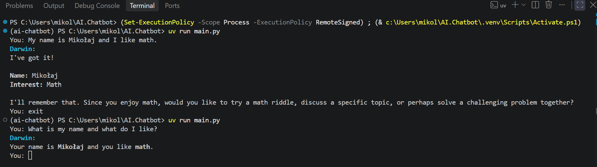

# Darwin – Local AI Assistant

Darwin is a personal AI assistant written in Python. It runs a large language model
locally on my own machine, remembers our conversations between sessions and streams
its answers live in the terminal.

> 🚧 Work in progress – Darwin is being developed step by step toward a voice-controlled
> assistant that can operate apps and Arduino-based hardware.

## Demo



## Features

- **Conversation memory** – chat history is saved to a JSON file and restored on startup
- **Live streaming** – answers appear token by token, rendered as Markdown with `rich`
- **Swappable model backend** – uses the OpenAI-compatible API, so switching between
  Ollama, LM Studio or llama.cpp only requires changing the server address
- **Fully local** – no cloud services, no data leaves the computer

## Tech stack

| Part | Tool |
|---|---|
| Language | Python 3.15 |
| Package manager | uv |
| Model server | Ollama |
| Model | Gemma 4 (26B MoE) by Google, served via Ollama |
| API client | openai |
| Terminal UI | rich |

## Getting started

1. Install [uv](https://docs.astral.sh/uv/) and [Ollama](https://ollama.com/)
2. Download the model:
   ```
   ollama pull gemma4:26b-a4b
   ```
3. Install dependencies and run:
   ```
   uv sync
   uv run main.py
   ```
4. Type `exit` to quit.

## Roadmap

- [x] Chat loop with conversation memory
- [x] Streaming responses with Markdown rendering
- [x] OpenAI-compatible backend
- [ ] Personality and rules via system prompt
- [ ] Tool calling (real data instead of guessing)
- [ ] Voice input and output
- [ ] Spotify control
- [ ] Arduino control over serial
- [ ] Speaker recognition

## License

MIT